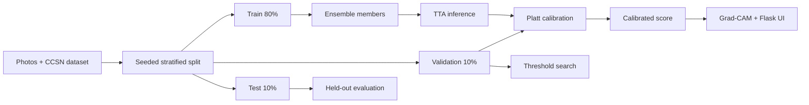

<div align="center">

# Cloud Classifier

**Cumulonimbus detection from one ground photograph.**

   

[](https://github.com/adineo-cmd/cloud_predict/stargazers) [](https://github.com/adineo-cmd/cloud_predict/commits)

[Quick start](#quick-start) · [How it works](#how-it-works) · [Features](#features)

</div>

---

Binary ground-based cloud classification: **cumulonimbus vs. everything
else**. A transfer-learning ensemble (EfficientNetV2-B0 by default) with
test-time augmentation, Platt calibration fitted on held-out validation data,
Grad-CAM explanations, a Flask UI and a one-command pipeline.

On the 256-image held-out test split the proposed configuration scores **93.36%
accuracy, 77.46% macro-F1 and 0.921 ROC-AUC**, with an expected calibration
error of 0.027.

## Features

| | Feature | What it does |
| --- | --- | --- |
| 🧠 | **Seed ensemble** | `CLOUD_ENSEMBLE_SIZE` members trained from different seeds, probabilities averaged at inference. |
| 🎯 | **Honest calibration** | Platt scaling is fitted on validation only; artefacts fitted on training data are rejected at inference. |
| 🖼️ | **Test-time augmentation** | Five views per image by default, configurable through `CLOUD_TTA`. |
| 🔥 | **Grad-CAM** | Every prediction can be returned with the region that drove it. |
| 💻 | **CLI** | `train`, `predict`, `evaluate`, `calibrate`, `history` and `benchmark` subcommands. |
| 🌐 | **Web UI** | A Flask app for dragging in an image and reading the calibrated score. |

## How it works

The pipeline is built so the reported metric is the metric that was measured:

1. **Split once, seed it.** `utils.stratified_split` produces a seeded 80/10/10
   split cached in `results/dataset_split.json`.
2. **Train on train only.** The 10% test split is never used for training,
   checkpointing, threshold search or calibration.
3. **Search on validation.** The decision threshold is chosen there and reported
   as its transfer to test.
4. **Calibrate on validation.** `calibration.py` fits Platt scaling and computes
   ECE; the calibration artefact records which split it came from.
5. **Average the ensemble.** Member probabilities are averaged, then the calibrated
   probability of the predicted class is what the UI shows — no agreement
   multiplier.



## Quick start

Python 3.9–3.12 with a virtualenv. TensorFlow is the only heavy dependency;
the rest are OpenCV, scikit-learn, pandas, matplotlib, click, rich and Flask.

**Full pipeline**

```bash
python3 -m venv .venv && source .venv/bin/activate
pip install -r requirements.txt
python run.py            # setup → train → calibrate → evaluate → benchmark → web
```

**Reuse an existing model**

```bash
python run.py quick     # straight to the web UI
```

**Individual steps**

```bash
python -m cli train
python -m cli evaluate
python -m cli predict img.jpg --json --gradcam
python app.py --port 8080
```

## Project structure

```text
cli/                train, predict, evaluate, calibrate, history, benchmark
  data.py           split → Keras generators, backbone preprocessing
utils.py            seeding + seeded stratified split
calibration.py      Platt and temperature scaling, ECE
train.py            ensemble training
predict.py          TTA inference + Grad-CAM
evaluate.py         held-out test metrics
app.py              Flask web UI
scripts/            CCSN download, TTA evaluation, paper assets
dataset/            cumulonimbus/ other/ (gitignored images)
models/             ensemble members (gitignored) + calibration.json
results/            evaluation_report.json, split cache, plots
```

## Configuration

| Variable | Default | Purpose |
| --- | --- | --- |
| `CLOUD_ENSEMBLE_SIZE` | `3` | Number of ensemble members |
| `CLOUD_BACKBONE` | `efficientnet_v2_b0` | Or `mobilenet_v2` |
| `CLOUD_IMG_SIZE` | `256` | Input resolution |
| `CLOUD_EPOCHS` | `15` | Phase-1 epochs; finetune is max(3, epochs/3) |
| `CLOUD_BATCH_SIZE` | `32` | Batch size |
| `CLOUD_TTA` | `5` | Test-time augmentation views |
| `CLOUD_THRESHOLD` | `0.5` | Score above the threshold means "other" |
| `CLOUD_SEED` | `42` | Base seed; members use seed + 1000·i |

## Results

Held-out test split, 256 images:

| Configuration | Accuracy | Macro-F1 | ROC-AUC | ECE |
| --- | --- | --- | --- | --- |
| MobileNetV2 (original recipe) | 90.62% | 57.51% | 0.833 | 0.017 |
| EfficientNetV2-B0 (one seed) | 92.97% | 74.42% | 0.894 | 0.018 |
| **Ensemble ×3 + Platt** | **93.36%** | **77.46%** | **0.921** | **0.027** |

Model weights are distributed on Hugging Face, not in git. The full IEEE-style
analysis is generated from `paper/`.

## Data

Training images are a mix of the author's own photographs and the public
[CCSN database](https://doi.org/10.7910/DVN/CADDPD) — 2,543 ground-based cloud
photos, with the cumulonimbus class mapped to `cumulonimbus` and every other class
to `other`. `python scripts/download_ccsn.py` reproduces the merge and caches the
zip under `data/`; images are gitignored.

If you use the merged dataset, cite Zhang et al., *"CloudNet: Ground-Based Cloud
Classification With Deep Learning"*, GRL 2018. The CCSN data keeps its own terms
on Harvard Dataverse.

## Contributing

Issues and pull requests are welcome. For anything larger than a typo or a
small fix, open an issue first so the approach can be agreed before the work.

- Bugs and ideas: [issues](https://github.com/adineo-cmd/cloud_predict/issues)

## License

MIT. See [LICENSE](LICENSE).
